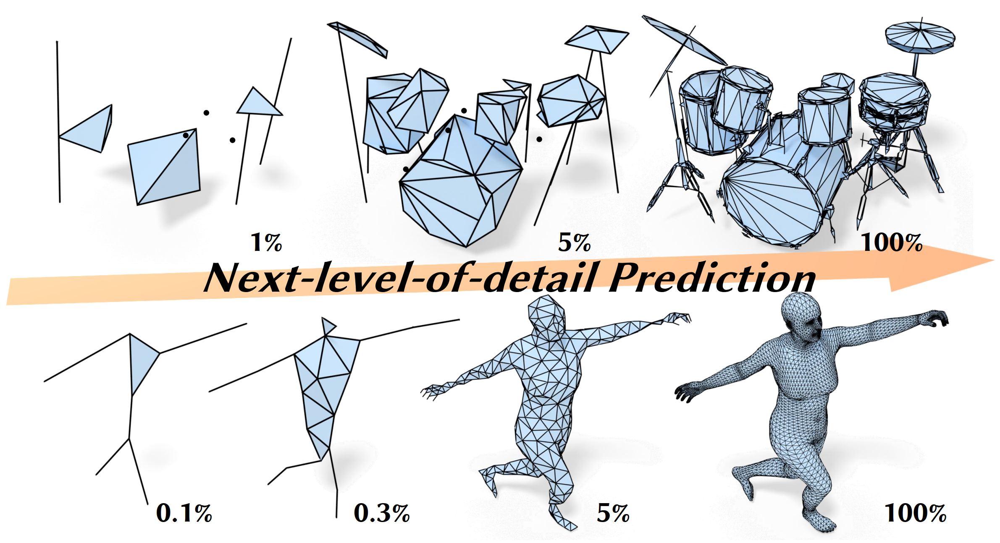

<div align="center">

  <h1 align="center">ARMesh: Autoregressive Mesh Generation <br> via Next-Level-of-Detail Prediction</h1>
  
  <div align="center" style="text-decoration: none;">
    <a href="https://jblei.site/"><b>Jiabao Lei</b></a>
    .
     <a href="https://keweis23.github.io/"><b>Kewei Shi</b></a>
    ·
    <a href="https://lzhnb.github.io/"><b>Zhihao Liang</b></a>
    ·
    <a href="http://kuijia.site/"><b>Kui Jia</b></a>
  </div>
  
  <h2 align="center">NIPS 2025</h2>
  <div align="center">
    <br>
    
  </div>
  
  <h3 align="center">
    In this work, we propose to serialize a mesh in the order of levels of detail (LODs) and train an autoregressive model to predict the next LOD. This is achieved by generalizing the mesh into a simplicial complex and modeling the inverse process of the mesh simplification algorithm.
  </h3>
  
  <p align="center"><br>
    <a href="https://arxiv.org/abs/2509.20824"></a>
    <a href='https://jblei.site/proj/armesh'></a>
  </p>

</div>


## Installation

### libpsc

We have packaged our core functionalities into a library called [`libpsc`](https://pypi.org/project/libpsc/0.2/), which you can install quite easily:

```bash
pip install trimesh # dependencies
pip install libpsc==0.2
```

Supported platforms: 
- python 3.8 ~ 3.13
- linux, windows


You can also find all the wheels [here](https://github.com/Karbo123/armesh/tree/main/assets/libpsc).
The source code is also [available](https://github.com/Karbo123/armesh/tree/main/assets/libpsc-0.2.zip).


### PSC Viewer

We also provide a "progressive simplicial complex" viewer to visualize the simplification and generation process. We have provided two pre-built executables that should run perfectly on Windows and Linux, which can be downloaded from [here](https://github.com/Karbo123/armesh/tree/main/assets/G3dOGL).


You first need to install some dependencies

```bash
pip install fire trimesh easygui libpsc # dependencies

# clone the repo that contains the executable
git clone https://github.com/Karbo123/armesh.git --depth=1
cd armesh
```


For example, to use the executable for visualizing `assets/example-chair.psc`, you may need to:

```
python vis/vis.py assets/example-chair.psc
```

<details>

<summary>If fail to run on Linux</summary>

1. **undefined symbol: omp_get_thread_num**: this often occurs if it does not use the system's OpenMP library. You may preload the system's OpenMP by setting the environment variable, something like: `export LD_PRELOAD="/usr/lib/gcc/x86_64-linux-gnu/9/libgomp.so"`

2. **error while loading shared libraries**: this often occurs if the executable fails to find these libraries. Fortunately, they are available after installing `libpsc`. You can specify the folder where these libraries reside by setting the environment variable `LD_LIBRARY_PATH`. You may do something like:

   ```
   cp /home/graphics/.local/lib/python3.8/site-packages/libpsc.libs/* .
   mv libpng15* libpng15.so.15
   mv libjpeg* libjpeg.so.62
   mv libqhull_r* libqhull_r.so.8.0
   export LD_LIBRARY_PATH=$(pwd)
   ```

</details>


## Examples and Experiments


You may need to properly set up the code environment for running experiments.

We highly suggest using Linux for training experiments because some used packages have poor support for Windows systems. To set up the packages, you may need the following dependencies, which can be installed through `pip`. The package versions listed below are just suggestions; other versions might work as well.

```
torch               2.6.0+cu126
pytorch-lightning   2.5.1
flash_attn          2.7.4.post1
deepspeed           0.16.6
wandb               0.19.9
trimesh             4.6.6
numpy               2.2.4
tqdm                4.67.1
fire                0.7.0
joblib              1.4.2
hydra-core          1.3.2
omegaconf           2.3.0
torchmetrics        1.7.1
retrying            1.3.4
numba               0.61.2
datrie              0.8.2
```


### Mesh Collection Learning


We provide 100 mesh examples in [this folder](assets/obj100). We will now present a minimalist experiment demonstrating how we can learn from this tiny dataset.

You can follow the steps below for the experiments:
```bash
# simplify the mesh, reverse the sequence
# write psc files to disk
# write "object_info.json"
python exp/1/1-preprocess-dataset.py

# tokenize each mesh, and write "op_tok.json"
python exp/1/2-tokenize.py

# learn vocabulary for tokenization compression ("vocab-bit-high.json" and "vocab-code-vfe.json")
python exp/1/3-learn-vocab.py --name="bit-high" --num_new_vocab=4096  --id_new_start=523  --range_start=2 --range_end=5 
python exp/1/3-learn-vocab.py --name="code-vfe" --num_new_vocab=11763 --id_new_start=4619 --range_start=8 --range_end=-1

# merge vocabulary and compressively tokenize each mesh ("vocab.json" and "op_tok_bpe.jsonl")
python exp/1/4-vocab-compress.py

# start training (some configurations are in "exp/1/cfg.yaml")
python exp/1/5-train.py

# unconditional generation (some configurations are in "exp/1/cfg.yaml")
# please change the path to checkpoint
python exp/1/6-gen.py resume=out/exp-1--YYYY-MM-DD--HH-MM-SS/ARMesh/abcdefgh/checkpoints/best.ckpt
```


## BibTex

If you find our work useful or use any part of our code, please consider citing our paper; your recognition means a great deal to us!
```
@misc{lei2025armeshautoregressivemeshgeneration,
      title={ARMesh: Autoregressive Mesh Generation via Next-Level-of-Detail Prediction}, 
      author={Jiabao Lei and Kewei Shi and Zhihao Liang and Kui Jia},
      year={2025},
      eprint={2509.20824},
      archivePrefix={arXiv},
      primaryClass={cs.GR},
      url={https://arxiv.org/abs/2509.20824}, 
}
```


